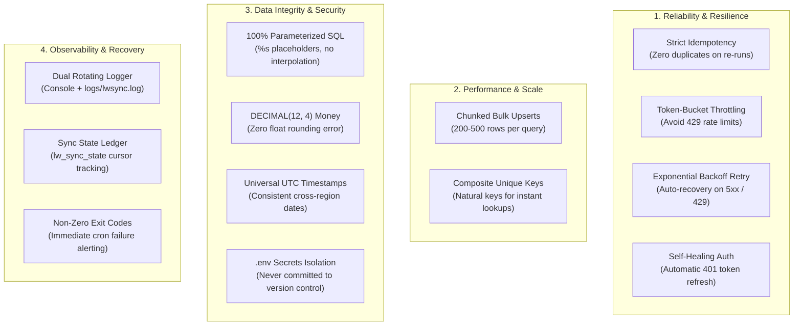

# Engineering Standards & Best Practices

This document outlines the architectural principles, database rules, and coding standards strictly enforced across the **BatteryClerk Linnworks to MySQL / MariaDB Sync** system.

---

## 1. Core Principles Overview

---

## 2. Detailed Standards Breakdown

### 1. Strict Idempotency (`INSERT ... ON DUPLICATE KEY UPDATE`)
- **Rule**: Running the synchronization job once, twice, or 100 times must yield the exact same database state with **zero duplicated rows**.
- **Implementation**:
  - Every table is designed with natural composite unique constraints:
    - Products: `UNIQUE KEY uq_products_region_sku (region, sku)`
    - Locations: `UNIQUE KEY uq_locations_region_loc (region, location_id)`
    - Stock Levels: `UNIQUE KEY uq_stock_region_sku_loc (region, sku, location_id)`
    - Orders: `UNIQUE KEY uq_orders_region_order_id (region, order_id)`
    - Order Items: `UNIQUE KEY uq_order_items_region_order_row (region, order_id, row_id)`
    - Refunds: `UNIQUE KEY uq_refunds_region_order_refund (region, order_id, refund_id)`
  - All write operations execute atomic upserts (`INSERT ... ON DUPLICATE KEY UPDATE`). If a record already exists, only changed fields and timestamps update.

---

### 2. Batch Processing & Bulk Upserts
- **Rule**: Never execute individual `INSERT` queries in a row-by-row loop for large datasets.
- **Implementation**:
  - Ingestion processes batch items into chunks of **200 to 500 rows per SQL execution**.
  - Minimizes round-trip network latency between the worker and MySQL / AWS RDS.
  - Reduces database transaction lock contention and prevents connection pool exhaustion.

---

### 3. Defense Against Schema Conflicts & Unmapped Fields
- **Rule**: Unexpected API response fields or custom extended properties must never crash the sync process.
- **Implementation**:
  - The catalog parser explicitly maps the 8 approved extended properties:
    - `Brand`
    - `Fill SKU`
    - `Product Line`
    - `MasterSKU`
    - `Substitute 1`
    - `Substitute 2`
    - `Mfr Part Number`
    - `Product Tag`
  - Any unrecognized property names returned from Linnworks are **logged as structured warnings** (`logger.warning("Unmapped extended property: ...")`) rather than throwing an exception.

---

### 4. Resilient HTTP Communication
- **Rule**: API interactions must respect rate limits and automatically recover from temporary outages.
- **Implementation**:
  - **Token Bucket Rate Limiting**: Enforces a strict threshold (`LW_RATE_LIMIT_RPS=2.0`, or 120 calls/minute) to stay safely below Linnworks' 150 calls/minute limit.
  - **Exponential Backoff**: Caught HTTP `429 (Too Many Requests)` and `5xx (Server Error)` responses automatically retry with exponential delays (`sleep = backoff * (2 ^ (attempt - 1))`) up to `MAX_RETRIES`.
  - **Self-Healing Auth (401 Handling)**: If a Linnworks session token expires mid-sync, the client invalidates the in-memory token, calls `AuthorizeByApplication` to generate a fresh token, and transparently retries the request without failing the job.

---

### 5. Data Integrity & Security
- **Rule**: Protect data from rounding loss, injection attacks, and timezone ambiguity.
- **Implementation**:
  - **SQL Injection Prevention**: All queries strictly utilize parameterized placeholders (`%s`). String formatting or interpolation (`f"INSERT INTO ... {val}"`) is strictly prohibited for SQL values.
  - **Financial Precision**: All monetary values (`subtotal`, `tax`, `shipping_charge`, `total`, `unit_price`, `cost`) are stored in `DECIMAL(12, 4)`. Floating-point types (`FLOAT`, `DOUBLE`) are banned.
  - **UTC Datetimes**: All dates (`created_at`, `updated_at`, `date_received`, `date_processed`, `refunded_at`) are converted and stored in **UTC**.
  - **Environment-Isolated Secrets**: Credentials, passwords, and tokens reside solely in `.env`, which is listed in `.gitignore`. Only `.env.example` with placeholder strings is tracked in version control.

---

### 6. Graceful Error Handling & State Recovery
- **Rule**: Scheduled jobs must provide a clear audit trail and signal failures clearly to cron runners.
- **Implementation**:
  - High-watermark timestamps and cursor offsets are persisted in `lw_sync_state` per `(region, entity)`.
  - On any unhandled exception, `lw_sync_state.last_error` is updated with the error traceback, and the process exits with a **non-zero exit code (`sys.exit(1)`)**.
  - External monitoring systems (e.g. AWS CloudWatch, Linux cron alert mailers) will immediately detect the non-zero status code and trigger alerts.

---

## 3. Checklist for Code Review

Before marking any sync module complete, verify:

- [ ] Does every write query use `INSERT ... ON DUPLICATE KEY UPDATE`?
- [ ] Are queries batched instead of executing one row at a time?
- [ ] Are all query values passed as parameter tuples (`cursor.execute(sql, params)`)?
- [ ] Are monetary columns defined as `DECIMAL(12, 4)`?
- [ ] Are all datetime objects naive UTC or converted to UTC before persistence?
- [ ] Does the client gracefully retry on HTTP 429 and 5xx errors?
- [ ] Does the sync runner record state and cursor updates into `lw_sync_state`?
- [ ] Are all test cases passing via `pytest` without warnings?

