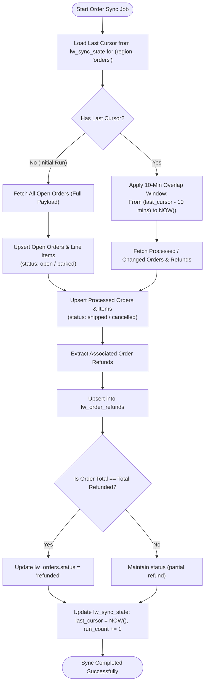
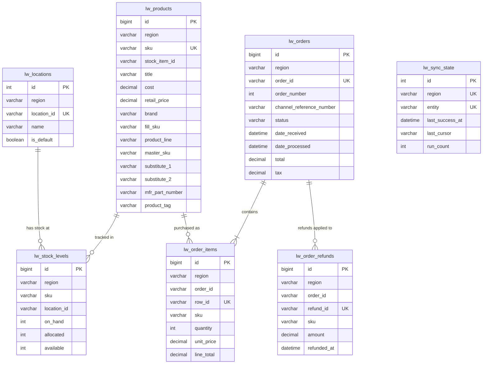

# Linnworks Data Sync — Architecture & Development Plan

This document details the complete architectural blueprints, synchronization flows, and development execution roadmap for the **BatteryClerk Linnworks to MySQL / MariaDB Sync** system.

---

## 1. High-Level System Architecture

The following diagram depicts how the application isolates environments, authenticates against both regional Linnworks instances (`US` and `CA`), and persists data idempotently into the target MySQL / MariaDB database.

```mermaid
flowchart TB
    subgraph Config_Layer["Configuration & Credentials"]
        ENV[".env / Config"]
        US_CREDS["US Instance Tokens & App ID"]
        CA_CREDS["CA Instance Tokens & App ID"]
        ENV --> US_CREDS
        ENV --> CA_CREDS
    end

    subgraph Client_Abstraction["Linnworks Client Abstraction"]
        BASE["LinnworksClient (Base Interface)"]
        FIXTURE["FixtureClient (Offline Mock JSON)"]
        LIVE["LiveClient (HTTP + Auth + Rate Limiter)"]
        
        BASE --> FIXTURE
        BASE --> LIVE
    end

    subgraph Data_Sources["Data Ingestion Layer"]
        MOCK_DIR[("fixtures/US/ & fixtures/CA/")]
        LW_API["Linnworks REST API (api.linnworks.net)"]
        
        FIXTURE -.->|Reads local JSON| MOCK_DIR
        LIVE -.->|HTTP + Throttling| LW_API
    end

    subgraph Sync_Engine["Core Sync Engine (lwsync)"]
        CLI["CLI Entrypoint (__main__.py)"]
        AUTO_INIT["Schema Guard (ensure_database_and_tables)"]
        PROD_SYNC["Products & Extended Properties Worker"]
        LOC_SYNC["Locations & Stock Levels Worker"]
        ORDER_SYNC["Orders & Line Items Worker"]
        REFUND_SYNC["Refunds & Status Transition Worker"]
        STATE_MGR["Sync State & Cursor Manager"]

        CLI --> AUTO_INIT
        AUTO_INIT --> STATE_MGR
        CLI --> PROD_SYNC
        CLI --> LOC_SYNC
        CLI --> ORDER_SYNC
        ORDER_SYNC --> REFUND_SYNC
    end

    subgraph Database_Layer["MySQL / MariaDB Target (Prefix: lw_)"]
        DB_PROD[("lw_products")]
        DB_LOC[("lw_locations")]
        DB_STOCK[("lw_stock_levels")]
        DB_ORDERS[("lw_orders")]
        DB_ITEMS[("lw_order_items")]
        DB_REFUNDS[("lw_order_refunds")]
        DB_STATE[("lw_sync_state")]
        DB_PIPE[("lw_pipeline_log (3PL Ready)")]
    end

    ENV -->|Sets LW_MODE| Client_Abstraction
    Client_Abstraction --> Sync_Engine

    PROD_SYNC -->|Upsert (region, sku)| DB_PROD
    LOC_SYNC -->|Upsert (region, location_id)| DB_LOC
    LOC_SYNC -->|Upsert (region, sku, location_id)| DB_STOCK
    ORDER_SYNC -->|Upsert (region, order_id)| DB_ORDERS
    ORDER_SYNC -->|Upsert (region, order_id, row_id)| DB_ITEMS
    REFUND_SYNC -->|Upsert (region, order_id, refund_id)| DB_REFUNDS
    REFUND_SYNC -->|Update status='refunded'| DB_ORDERS
    STATE_MGR <-->|Read & Update Cursor| DB_STATE
```

---

## 2. Order Sync Execution & Delta Workflow

This flowchart explains the intelligent dual-sync strategy: Open Orders vs Delta Processed Orders with an overlap safety window.



---

## 3. Phased Development Roadmap

The development workflow is organized into **6 sequential phases** directly mapped to the manager prompt's review milestones. Each phase delivers a standalone, fully verified module with clear entry/exit criteria and status tracking.

```mermaid
flowchart TD
    %% Global Styling
    classDef done fill:#d4edda,stroke:#28a745,stroke-width:2px,color:#155724;
    classDef current fill:#cce5ff,stroke:#007bff,stroke-width:3px,color:#004085;
    classDef pending fill:#fff3cd,stroke:#ffc107,stroke-width:2px,color:#856404;
    classDef future fill:#f8f9fa,stroke:#6c757d,stroke-width:1px,color:#383d41;

    %% Phase 1
    subgraph P1["Phase 1: Project Setup & Schema Architecture (COMPLETED)"]
        direction TB
        P1_1["1.1 Python 3.12 Virtual Env & requirements.txt"]
        P1_2["1.2 Environment Configuration (.env, .env.example)"]
        P1_3["1.3 MySQL/MariaDB DDL: 8 Tables with lw_ prefix"]
        P1_4["1.4 Auto-Schema Guard (CREATE TABLE IF NOT EXISTS)"]
        P1_5["1.5 Rotating File & Console Logger (lwsync.log)"]
        P1_1 --> P1_2 --> P1_3 --> P1_4 --> P1_5
    end
    class P1,P1_1,P1_2,P1_3,P1_4,P1_5 done;

    %% Phase 2
    subgraph P2["Phase 2: Linnworks Client & Mock Data Layer (COMPLETED)"]
        direction TB
        P2_1["2.1 LinnworksClient Abstract Base Interface"]
        P2_2["2.2 LiveClient: Token Auth, 401 Re-auth & Backoff Retries"]
        P2_3["2.3 Token Bucket Rate Limiting (Configurable RPS)"]
        P2_4["2.4 FixtureClient with Realistic US/CA Datasets"]
        P2_5["2.5 Pytest Suite: Auth, Fixtures & Throttling (10/10 Passing)"]
        P2_1 --> P2_2 --> P2_3 --> P2_4 --> P2_5
    end
    class P2,P2_1,P2_2,P2_3,P2_4,P2_5 done;

    %% Phase 3
    subgraph P3["Phase 3: Catalog & Inventory Synchronization (ACTIVE FOCUS)"]
        direction TB
        P3_1["3.1 PyMySQL Context Manager & Bulk Upsert Engine"]
        P3_2["3.2 Product Sync Worker: (region, sku) Upsert"]
        P3_3["3.3 Extended Properties Column Mapper (8 Props + Log Unknowns)"]
        P3_4["3.4 Locations Sync Worker: (region, location_id)"]
        P3_5["3.5 Stock Levels Sync Worker: (region, sku, location_id)"]
        P3_6["3.6 Deliverable 3 Integration Tests (US & CA Data)"]
        P3_1 --> P3_2 --> P3_3 --> P3_4 --> P3_5 --> P3_6
    end
    class P3,P3_1,P3_2,P3_3,P3_4,P3_5,P3_6 current;

    %% Phase 4
    subgraph P4["Phase 4: Order Lifecycle, Refunds & CLI Runner (NEXT SPRINT)"]
        direction TB
        P4_1["4.1 Open Orders Ingestion (Full Payload & Line Items)"]
        P4_2["4.2 Delta Cursor Query Engine (10-min safety overlap)"]
        P4_3["4.3 Line Item Sync into lw_order_items: (region, order_id, row_id)"]
        P4_4["4.4 Order Refund Worker: Line-level & Order-level Refunds"]
        P4_5["4.5 Status State Machine: Trigger orders.status='refunded'"]
        P4_6["4.6 CLI Runner (python -m lwsync run ... with --dry-run)"]
        P4_7["4.7 Sync State High-Watermark Tracker (lw_sync_state)"]
        P4_1 --> P4_2 --> P4_3 --> P4_4 --> P4_5 --> P4_6 --> P4_7
    end
    class P4,P4_1,P4_2,P4_3,P4_4,P4_5,P4_6,P4_7 pending;

    %% Phase 5
    subgraph P5["Phase 5: Idempotency, Edge Cases & Verification Suite"]
        direction TB
        P5_1["5.1 Duplicate Run Idempotency Test (Zero Row Drift)"]
        P5_2["5.2 Status Transition Tests (open -> shipped -> refunded)"]
        P5_3["5.3 Partial Refund vs Full Refund Verification"]
        P5_4["5.4 Dual-Region SKU Collision Validation (US vs CA)"]
        P5_1 --> P5_2 --> P5_3 --> P5_4
    end
    class P5,P5_1,P5_2,P5_3,P5_4 future;

    %% Phase 6
    subgraph P6["Phase 6: Production Readiness & Documentation"]
        direction TB
        P6_1["6.1 Production README.md & Setup Instructions"]
        P6_2["6.2 Linux / AWS RDS Crontab Schedules"]
        P6_3["6.3 Step-by-Step Transition Guide: Fixture to Live API"]
        P6_4["6.4 Error Alerting & Non-Zero Exit Code Validation"]
        P6_1 --> P6_2 --> P6_3 --> P6_4
    end
    class P6,P6_1,P6_2,P6_3,P6_4 future;

    %% Phase Transitions
    P1 ==>|Schema & Logging Ready| P2
    P2 ==>|Clients & Fixtures Validated| P3
    P3 ==>|Catalog & Inventory Live in DB| P4
    P4 ==>|Orders & Refunds Flowing| P5
    P5 ==>|All Edge Cases Verified| P6
```



### Roadmap Milestones & Review Gates

| Phase | Milestone Name | Status | Deliverables | Verification Criteria |
| :---: | :--- | :---: | :--- | :--- |
| **1** | **Scaffolding & DB Schema** | **COMPLETED** | `requirements.txt`, `.env.example`, `001_create_tables.sql`, `lwsync/db.py` | All 8 `lw_*` tables verified in MySQL, auto-created on run. |
| **2** | **API Client & Fixtures** | **COMPLETED** | `base.py`, `live.py`, `fixture.py`, `auth.py`, test mock JSONs | 10/10 pytest passing with 401 retry, 429 backoff & RPS throttling. |
| **3** | **Catalog & Stock Sync** | **COMPLETED** | `lwsync/sync/products.py`, `lwsync/sync/inventory.py`, bulk upsert engine | Products, 8 extended properties, locations, and stock upsert into DB without duplicates. |
| **4** | **Orders, Refunds & CLI** | **COMPLETED** | `lwsync/sync/orders.py`, `lwsync/sync/refunds.py`, CLI commands | Delta sync with 10-min overlap window, auto-marking `refunded` orders, `--dry-run` flag. |
| **5** | **Idempotency & Verification** | **IN PROGRESS** | `tests/test_idempotency.py`, `tests/test_status_mapping.py` | Double sync execution gives identical table row counts; partial vs full refund tested. |
| **6** | **Docs & Crontab Deploy** | **PENDING** | `README.md`, crontab definitions, Live API transition guide | Client can transition from local fixture mode to live AWS RDS/MariaDB by changing config only. |

---

## 4. Entity Relationship Diagram (ERD)

The database schema models the relationships between products, stock locations, orders, and refund transactions with composite unique keys.



